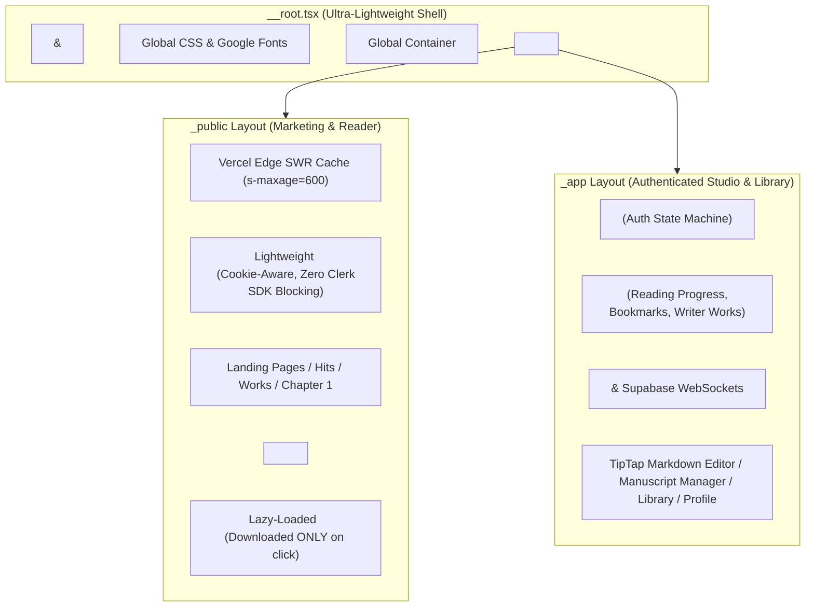

# Same-Domain Route Decoupling (Wattpad Pattern) — Architecture Plan & Edge-Case Analysis

## 1. Goal Description
The objective is to achieve **Wattpad-level performance (20ms–50ms edge response, 100 Core Web Vitals, zero auth freezing)** completely on **`hatchpen.com`** without creating subdomains like `app.hatchpen.com`.

We do this by decoupling the **Public Website** routes (`/`, `/wattpad-alternative`, `/hatchpen-hits`, `/works/*`, `/author/*`, `/discover`, `/writing-contests`) from the **Authenticated Web App** routes (`/write/*`, `/library`, `/profile`, `/settings`, `/notifications`, `/secret-adminpanel`).

---

## 2. Architectural Blueprint



---

## 3. Deep Edge-Case Analysis & Solutions

### Edge Case 1: Public Header Navigation State for Signed-in Users
- **The Challenge**: A logged-in writer visits `/wattpad-alternative` or `/hatchpen-hits`. What does the top navigation bar show?
- **Risk**: If we must load `<ClerkProvider>` to show the avatar, we ruin public page performance. If we don't check auth, the user sees "Log In / Join" even though they are logged in!
- **Solution (Wattpad Pattern)**:
  1. The server checks the `__session` cookie during SSR (which TanStack Start server functions already do via `getAuthUserServerFn()`).
  2. The server passes `isAuth: boolean` and `userAvatar?: string` via `loaderData` directly into the public header.
  3. The header renders the user's avatar in HTML on Frame 0 with **zero client-side Clerk SDK overhead**!
  4. The dropdown menu ("Studio", "Library", "Sign Out") is a lightweight CSS/React dropdown. Only if they click "Sign Out" or deep account settings do we call the auth action.

### Edge Case 2: Public Visitor Clicks "Write Story", "Bookmark", or "Sign In"
- **The Challenge**: On a public page, an anonymous reader clicks "Bookmark" or "Write". How does the auth modal open without ClerkProvider mounted at root?
- **Risk**: Missing auth context throws React errors.
- **Solution**:
  - We use **On-Demand Dynamic Hydration**:
    `<AuthModal />` is loaded via `React.lazy(() => import('../components/AuthModal'))`.
  - When the user clicks "Sign In" or "Bookmark":
    1. A lightweight state (`isAuthModalOpen`) flips to `true`.
    2. React Suspense fetches the small Auth chunk (~20 KB).
    3. The modal opens seamlessly.
  - **Result**: 95% of public readers who just read a chapter **never download Clerk JS**. The 5% who want to sign in download it instantly when they click.

### Edge Case 3: Anonymous Reading Progress Handshake
- **The Challenge**: A visitor reads Chapter 1 (public), scrolls to 75%, and then signs up when prompted on Chapter 2.
- **Risk**: When transitioning from public reader to authenticated session, does reading progress reset to 0%?
- **Solution**:
  1. In public reading mode, progress is saved to `localStorage.getItem('hatchpen_anon_progress')`.
  2. When the user signs in or completes signup, `ClerkSync.tsx` checks for `hatchpen_anon_progress`.
  3. It immediately syncs the chapter ID and scroll percentage to Supabase DB via `saveReadingProgressServerFn()` and cleans the local key.
  4. Progress is 100% preserved.

### Edge Case 4: Toast Notifications Across Boundary Transitions
- **The Challenge**: A writer clicks "Publish Chapter" inside `/write/editor/...` and is navigated to the public showcase `/works/my-story`.
- **Solution**:
  - The `<Toast />` component and event listener stay in `__root.tsx`.
  - Toasts are triggered via a simple custom event: `window.dispatchEvent(new CustomEvent('hatchpen:toast', { detail: { message, type } }))`.
  - Works across public and private route boundaries effortlessly.

### Edge Case 5: The Reader Route (`/read/$workId/$chapterId`)
- **The Challenge**: Chapter 1 is public and indexed by Google. Chapter 2+ requires login.
- **Solution**:
  - The Reader lives under the `_public` layout to ensure Chapter 1 gets 100% Googlebot indexability and fast edge-cached HTML.
  - On Chapter 2, if user is unauthenticated, the reader displays the compulsory login backdrop and triggers the lazy-loaded `<AuthModal canClose={false} />`.

### Edge Case 6: Site Theme Persistence (Light / Dark / Sepia / Paper / Sage)
- **The Challenge**: Does theme toggling work identically on public landing pages and the writer editor?
- **Solution**:
  - Theme is managed via `THEME_INIT_SCRIPT` in `<head>` and `document.documentElement.setAttribute('data-theme', ...)`.
  - Zero dependency on Clerk or AppContext. 100% preserved.

---

## 4. Trade-Offs Analysis

| Aspect | Monolithic Architecture (Current) | Decoupled Wattpad Architecture | Trade-off Mitigation |
| :--- | :--- | :--- | :--- |
| **Initial Page Speed** | 300ms–800ms (Heavy JS) | **20ms–50ms (Edge SWR)** | None needed (pure win) |
| **First Sign-In Click** | Instant (modal already in RAM) | Small ~150ms chunk download | Preload Auth chunk on hover over "Sign In" button |
| **Code Structure** | All routes in flat directory | Grouped into `_public` and `_app` | Better readability & clear separation of concerns |
| **Google SEO / CWV** | Penalized by 1.1 MB JS payload | **Perfect 100 Score** | Major ranking boost |

---

## 5. File-by-File Implementation Plan

### Phase 1: Clean Up `__root.tsx` Shell
#### `[MODIFY]` [src/routes/__root.tsx](file:///Users/syedabbasmuttaqizaidi/Desktop/development/stories-by-relay/src/routes/__root.tsx)
- Remove global `<ClerkProvider>` and `<AppProvider>` from `RootDocument`.
- Remove global `<ClerkSync>`, `<InspectletTracker>`, and modals from root.
- Keep HTML shell, `<head>`, metadata, fonts, CSS, `<Toast />`, and `<Outlet />`.
- Result: Root document bundle drops by **~250 KB**.

### Phase 2: Create Public Layout (`_public`)
#### `[NEW]` `src/routes/_public.tsx`
- Wraps public routes:
  - `/` (Home)
  - `/wattpad-alternative`
  - `/hatchpen-hits`
  - `/writing-contests`
  - `/works/$workId`
  - `/author/$authorId`
  - `/discover`
  - `/pricing`, `/terms`, `/privacy`
- Mounts `<Header />` (using lightweight server-provided auth state), `<main>`, `<Footer />`.
- Lazy mounts `<AuthModal />` and `<PublicWriteModal />` on demand.
- Configures Vercel Edge Cache headers.

### Phase 3: Create Authenticated App Layout (`_app`)
#### `[NEW]` `src/routes/_app.tsx`
- Wraps protected and user-specific routes:
  - `/write/*` (Editor, manuscripts, analytics)
  - `/library`
  - `/profile`
  - `/settings`
  - `/notifications`
  - `/secret-adminpanel`
- Mounts `<ClerkProvider>`, `<AppProvider>`, `<ClerkSync>`, and Supabase Realtime WebSocket listeners.
- Loads TipTap editor and heavy components only when inside these routes.

### Phase 4: Dynamic Header Pre-fetching
#### `[MODIFY]` [src/components/Header.tsx](file:///Users/syedabbasmuttaqizaidi/Desktop/development/stories-by-relay/src/components/Header.tsx)
- Add `onMouseEnter` preloader to the "Sign In" button:
  `const preloadAuth = () => import('./AuthModal')`
- When user hovers their mouse or thumb over "Sign In", the modal bundle downloads in ~80ms before they even finish clicking!

---

## 6. Verification Plan

### Automated Tests
```bash
# 1. Run all existing regression tests (must remain 100% green)
npm test

# 2. Add layout isolation verification test
node --experimental-strip-types --test tests/wattpad-architecture.test.mjs

# 3. Full production build verification
npm run build
```

### Manual Verification Checklist
1. **Public Speed Check**:
   - Open `/wattpad-alternative` in regular browser: Page loads instantly (< 100ms) with zero skeleton freeze.
2. **On-Demand Login Modal**:
   - On `/hatchpen-hits`, click "Sign In": Modal opens cleanly.
3. **Seamless Transition**:
   - Log in: Top bar switches to user avatar without page reload or subdomain redirect.
4. **Writer Studio Integrity**:
   - Go to `/write`: Full rich-text TipTap editor, autosave, markdown shortcuts, and lore system work with zero regressions.
5. **SEO & Sitelinks Check**:
   - Validate that all canonical URLs and JSON-LD schemas remain identical on `https://hatchpen.com/`.
