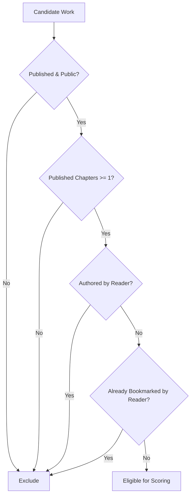
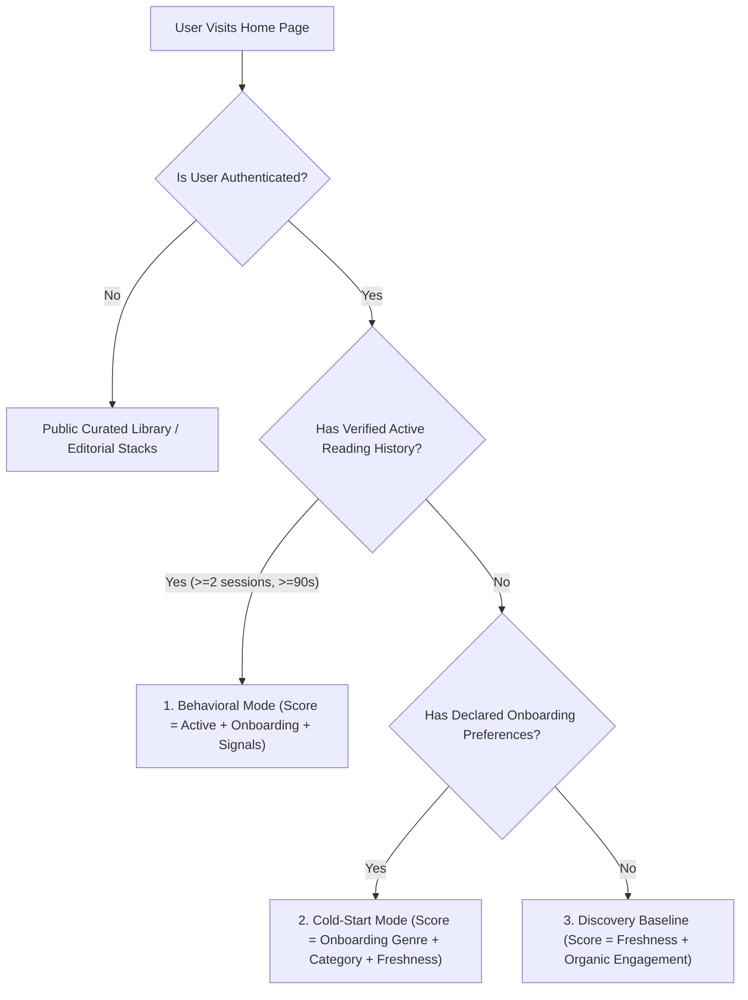

# Hatchpen — Recommendation System Formula & Architecture Specification

> **Status:** Production Implemented & Verified  
> **Test Suite:** `tests/for-you-recommendations.test.mjs` (41 passing invariants)  
> **Core Engine:** [`src/lib/recommendations/engine.ts`](file:///Users/syedabbasmuttaqizaidi/Desktop/development/stories-by-relay/src/lib/recommendations/engine.ts)  
> **Engine Config:** [`src/lib/recommendations/config.ts`](file:///Users/syedabbasmuttaqizaidi/Desktop/development/stories-by-relay/src/lib/recommendations/config.ts)  
> **Server Handshake:** [`src/server/recommendations.ts`](file:///Users/syedabbasmuttaqizaidi/Desktop/development/stories-by-relay/src/server/recommendations.ts) & [`src/server/reader.ts`](file:///Users/syedabbasmuttaqizaidi/Desktop/development/stories-by-relay/src/server/reader.ts)  
> **Client Consumer:** [`src/routes/index.tsx`](file:///Users/syedabbasmuttaqizaidi/Desktop/development/stories-by-relay/src/routes/index.tsx) (`LoggedInHome`)

---

## 1. System Overview

Hatchpen's **"For You"** recommendation engine provides personalized serialized fiction and literature recommendations without relying on unpredictable external LLMs, vector databases, or high-latency embeddings. 

The architecture is **deterministic, privacy-first, and behavior-driven**:
1. **Behavioral Taste Shift Over Static Onboarding:** A reader's verified active reading behavior takes precedence over preferences declared during onboarding.
2. **Gradual Adaptation Safeguard:** Brief interactions, quick clicks, or fast scrolls (< 90 seconds or single sessions) **never** override reader preferences.
3. **Cold-Start Resilience:** New readers with zero reading history smoothly receive recommendations based on onboarding preferences.
4. **Hard Exclusions:** Readers never see their own works, already bookmarked/saved manuscripts, drafts, unlisted works, or works without published chapters.
5. **Deterministic Output:** Results are capped at $\le 10$ unique works, strictly deduplicated, and accompanied by authentic explanation labels reflecting the primary signal driver.

---

## 2. Hard Eligibility & Exclusion Pipeline

Before any manuscript is evaluated for scoring, it must pass all baseline eligibility gates in `isWorkEligibleForRecommendations(...)`:



### Exclusion Criteria:
1. **Publication Status:** `work.status !== 'Cancelled'` and `work.visibility NOT IN ('Draft', 'Unlisted')`.
2. **Chapter Readiness:** `work.publishedChaptersCount >= 1` (or `work.chapters.some(c => c.status === 'published')`). Zero-chapter shells or drafts-only manuscripts are strictly filtered out.
3. **Author Exclusion (Self-Reading Safeguard):** `author_id != currentUserId` and `author_id != currentUserProfileId`. Authors are never tracked or recommended their own stories.
4. **Bookmark & Saved Exclusion:** Works present in `savedWorkIds` (client) or `bookmarks` table (PostgreSQL) are excluded from "For You" to leave space for fresh discoveries.

---

## 3. Active Reading Heartbeat & Tracking System

Taste shifts are powered by an active reading tracker implemented in [`src/routes/read.$workId.$chapterId.tsx`](file:///Users/syedabbasmuttaqizaidi/Desktop/development/stories-by-relay/src/routes/read.$workId.$chapterId.tsx) and [`recordReadingHeartbeatServerFn`](file:///Users/syedabbasmuttaqizaidi/Desktop/development/stories-by-relay/src/server/reader.ts).

### Mechanics:
- **Active Accumulation:** Reading time accumulates **only** while the browser tab has `document.visibilityState === 'visible'`.
- **Visibility Pausing:** When a user switches tabs or minimizes the window, the accumulator freezes and flushes the elapsed slice to the server.
- **Delta Bounding:** Heartbeat payloads are clamped to $[0, 60]$ seconds per flush to prevent client-side time-spoofing.
- **Periodic Flush:** Heartbeat fires automatically every 15 seconds, and on tab unload.
- **Chapter Completion Rule:**
  $$\text{Completed} = (\text{endMarkerReached} == \text{true}) \land (\text{totalActiveSeconds} \ge \max(25, \text{readTimeMinutes} \times 15))$$
  Fast scrolling to the bottom without attentive reading does **not** count as completed.

---

## 4. The Recommendation Scoring Formula

Eligible candidate works are scored through non-overlapping additive signals. The maximum possible individual base score is bounded at $100$ points.

$$\text{Final Score} = S_{\text{active}} + S_{\text{onboarding\_genre}} + S_{\text{onboarding\_category}} + S_{\text{freshness}} + S_{\text{organic}}$$

### Signal Weights Breakdown

| Signal | Identifier in Config | Points | Trigger Condition |
| :--- | :--- | :---: | :--- |
| **Active Reading Affinity** | `ACTIVE_READING_GENRE_AFFINITY` | **40** | Story genre matches verified top active reading genre from recent sessions. |
| **Onboarding Genre Match** | `ONBOARDING_GENRE_MATCH` | **25** | Story genre matches reader's declared genres selected during onboarding. |
| **Onboarding Category Match** | `ONBOARDING_CATEGORY_MATCH` | **15** | Story category/format matches reader's declared category interests. |
| **Living Serial Freshness** | `RECENT_CHAPTER_DROP_BONUS` | **10** | Chapter published in the past 14 days or `new_chapters_this_week === true`. |
| **Organic Quality Baseline** | `ORGANIC_ENGAGEMENT_BONUS` | **10** | High organic engagement (`totalReads > 5000`, `featured`, or `trending`). |
| **Total Maximum Score** | | **100** | |

---

## 5. Taste Shift Detection Engine

Before scoring, the engine analyzes the reader's session log within a configurable rolling lookback window via `detectActiveReadingShift(...)`:

```
Lookback Window: LOOKBACK_DAYS = 14 days
Shift Qualification Thresholds:
  - MIN_SESSIONS_FOR_TASTE_SHIFT: 2 distinct reading sessions
  - MIN_ACTIVE_SECONDS_FOR_TASTE_SHIFT: 90 seconds cumulative active reading
```

### Adaptation Logic:
1. Sessions within the last 14 days are grouped by the story's genre.
2. For each genre, total active duration ($\sum \text{seconds}$) and session count ($\sum \text{sessions}$) are aggregated.
3. If a genre exceeds $\ge 2$ sessions and $\ge 90$ seconds, it becomes an eligible **Active Taste Candidate**.
4. The candidate with the highest active reading duration is crowned `topGenreSlug`.
5. **Brief Skim Protection:** If a reader clicks a story in another genre and leaves after 30 seconds or 1 session, the shift does **not** trigger, preventing recommendation noise.
6. **Immutability Principle:** The user's persisted preferences object in `profiles.preferences` is **never mutated** by reading activity; taste shifting is computed dynamically as an overlay.

---

## 6. Cold-Start & Fallback Hierarchy

The system handles various lifecycle stages gracefully:



1. **Active Reader ($\ge 90$s in genre):** Recommendations prioritize their current passion (`"Based on your recent reading in [Genre]"`).
2. **Cold-Start (New registered reader):** When reading history is empty, onboarding preferences act as the primary scoring driver (`"Based on your interest in [Genre]"`).
3. **Exhausted / Unspecified Preferences:** If no personal signals match, fresh active serials and high-engagement works populate the feed (`"Recommended Serial"`).

---

## 7. Ranking, Diversity & Deduplication

Once scored:
1. **Primary Sort:** Candidates are sorted in descending order of `score`.
2. **Tie-Breaker:** For identical scores, sorted by total organic reader volume (`totalReads`).
3. **Deduplication:** A `Set<string>` guarantees that each manuscript ID appears at most once.
4. **Capping:** Sliced to strictly $\le 10$ recommendations (`MAX_RECOMMENDATIONS = 10`).
5. **Authentic Explanations:**
   - Active driver: `"Based on your recent reading in Fantasy"`
   - Onboarding driver: `"Based on your interest in Sci-Fi"`
   - Category driver: `"Recommended Serialized Novel"`
   - General driver: `"Recommended Serial"`

---

## 8. Database Schema Integration (PostgreSQL / Supabase)

Signals are queried via [`src/server/recommendations.ts`](file:///Users/syedabbasmuttaqizaidi/Desktop/development/stories-by-relay/src/server/recommendations.ts) with zero unnecessary joins:

```sql
-- 1. Bookmarked works to exclude
SELECT work_id 
FROM bookmarks 
WHERE user_id = :profileId;

-- 2. Reading history within lookback window
SELECT work_id, chapter_id, duration_seconds, last_read_at 
FROM reading_history 
WHERE user_id = :profileId 
  AND last_read_at >= NOW() - INTERVAL '30 days' 
ORDER BY last_read_at DESC;

-- 3. Onboarding preferences
SELECT preferences 
FROM profiles 
WHERE clerk_user_id = :clerkUserId;
```

---

## 9. Verification & Invariants Matrix

All requirements are validated by automated regression tests in [`tests/for-you-recommendations.test.mjs`](file:///Users/syedabbasmuttaqizaidi/Desktop/development/stories-by-relay/tests/for-you-recommendations.test.mjs):

- [x] **Taste Shift Priority:** Active reading genre strictly outranks static onboarding genre.
- [x] **Skim Resistance:** Single session (<90s) does not trigger taste shift.
- [x] **Cold-Start Fallback:** Empty reading history safely uses onboarding preferences.
- [x] **Self-Work Exclusion:** Author's own works are strictly excluded.
- [x] **Bookmark Exclusion:** Already bookmarked works (client or server) are strictly excluded.
- [x] **Draft/Unlisted Exclusion:** Incomplete or private manuscripts are excluded.
- [x] **Zero Published Chapters Exclusion:** Works with 0 published chapters are strictly excluded.
- [x] **Result Cap & Deduplication:** Maximum 10 items, zero duplicate IDs.
- [x] **Immutability:** User preferences object is never modified during calculation.
- [x] **Lookback Window Enforcement:** Sessions older than 14 days are discarded.
