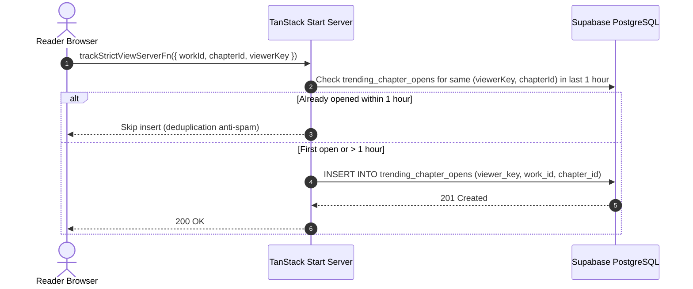
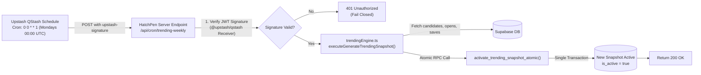

# HatchPen Trending V1 — Architecture, Calculation Engine & Operations

> **Version**: 1.0.0  
> **Target Environment**: HatchPen Production (`hatchpen.com`)  
> **Stack**: Supabase PostgreSQL, Nitro Server Handlers, Upstash QStash, Vite / React  
> **Last Verified**: October 2026

---

## 1. Executive Summary & Core Philosophy

HatchPen Trending V1 replaces static or unranked home discovery with a deterministic, data-driven, weekly snapshot-based ranking engine. 

### Core Design Principles:
1. **Weekly Snapshot Cadence**: Trending rankings are calculated weekly on a fixed cadence (Mondays 00:00:00 UTC) rather than calculated dynamically on every page request. This guarantees zero query overhead on live database traffic.
2. **Atomic Snapshot Swap**: Snapshot activation uses a PostgreSQL `SECURITY DEFINER` transaction. An old active snapshot is replaced by the new snapshot in a single atomic transaction, preventing downtime or race conditions.
3. **Decoupled Architecture**: Trending V1 is completely isolated from "Recommended for You" (which uses reader preference vectors) and "Admin Cover Management" (which handles visual assets).
4. **Resilience to Viral Anomalies**: Scoring uses logarithmic dampening (`ln(1 + x)`) to prevent a one-day burst from overshadowing stories with high reader engagement and chapter completion.
5. **No Manipulation via Vanity Metrics**: Likes, lifetime views, and author follower counts have **0% weight** in Trending calculations.

---

## 2. Mathematical Scoring Formula & Algorithm

The engine evaluates candidate stories over a rolling 7-day window (`[T - 7 days, T]`).

### 2.1 Component Weights
The Trending score is computed as:

$$\text{Score} = 0.50 \times \ln(1 + \text{UniqueReaders}_{7d}) + 0.35 \times \ln(1 + \text{UniqueSaves}_{7d}) + 0.15 \times \text{MeanChapterReach}$$

| Component | Weight | Mathematical Transform | Purpose |
| :--- | :--- | :--- | :--- |
| **Unique 7-Day Readers** | **50%** | $0.50 \times \ln(1 + R)$ | Measures audience breadth while dampening viral bot/click surges |
| **Unique 7-Day Saves** | **35%** | $0.35 \times \ln(1 + S)$ | Measures strong reader intent and retention signal |
| **Mean Chapter Reach** | **15%** | $0.15 \times \text{Reach}$ ($0.0 \le \text{Reach} \le 1.0$) | Rewards stories whose readers complete multiple chapters |
| **Likes / Lifetime Views** | **0%** | None | Excluded entirely to prevent vanity metric gaming |

---

### 2.2 Mean Chapter Reach Calculation

For each distinct reader $i$ who opened at least one chapter of work $W$ during the rolling 7-day window:

$$\text{ReaderReach}_i = \min\left(1.0, \frac{\text{DistinctPublishedChaptersOpenedByReader}_i}{\text{TotalPublishedChaptersCount}_W}\right)$$

The aggregate reach for the work is the arithmetic mean across all its 7-day readers:

$$\text{MeanChapterReach}_W = \frac{1}{N} \sum_{i=1}^{N} \text{ReaderReach}_i \quad (N = \text{UniqueReaders}_{7d})$$

*If a story has 0 readers in the 7-day window, $\text{MeanChapterReach} = 0.0$.*

---

### 2.3 Two-Tier Classification (Quality Guardrail)

Stories are partitioned into two tiers based on their completion threshold:

- **Tier A** ($\text{MeanChapterReach} \ge 0.80$): High-completion serialized works where readers read at least 80% of published chapters on average.
- **Tier B** ($\text{MeanChapterReach} < 0.80$): Lower-completion works or single-chapter drops.

> [!IMPORTANT]
> **Strict Tier Priority**: In final rankings, **every Tier A story strictly precedes all Tier B stories**, regardless of raw logarithmic score. This ensures quality retention is prioritized over pure click volume.

---

### 2.4 Deterministic Tie-Breaking Cascade

If two stories have identical metrics, ties are broken deterministically in the following order:
1. **Tier Priority**: Tier A > Tier B
2. **Score**: Descending score
3. **Unique Saves**: Descending 7-day saves count
4. **Unique Readers**: Descending 7-day unique readers count
5. **Work ID**: Deterministic alphabetical comparison (`work_id.localeCompare(other_id)`)

---

### 2.5 Author Diversity Guardrail
To ensure the Trending section remains diverse:
- Maximum **2 stories per author** are permitted in the Top 10.
- If an author has a 3rd top-ranking story, it is deferred to fill remaining slots only if fewer than 10 unique author stories exist across the entire platform.

---

## 3. Data Collection & Ingestion Pipeline

### 3.1 Chapter Open Tracking
Whenever a user reads a chapter (`/read/$workId/$chapterId`), `trackStrictViewServerFn` in `src/server/works.ts` records the engagement event:



- **Anti-Spam Window**: Repeated page refreshes or quick re-mounts by the same `viewer_key` within **1 hour** are ignored.
- **Fail-Safe / Non-Blocking**: The insert runs inside a `try/catch` block. If tracking fails for any reason, the user's reading experience is never interrupted.

### 3.2 Bookmark / Save Tracking
Saves are pulled directly from the existing `bookmarks` table:
- Filtered by `created_at >= window_start` and `created_at <= window_end`.
- Deduplicated per user and per work.

---

## 4. Database Schema & Architecture

All Trending V1 database objects were introduced via Supabase Migration 25 (`20261028000025_trending_v1_schema_and_tracking.sql`).

### 4.1 `trending_chapter_opens` Table
Stores rolling reader activity.
```sql
CREATE TABLE IF NOT EXISTS public.trending_chapter_opens (
    id UUID PRIMARY KEY DEFAULT gen_random_uuid(),
    viewer_key TEXT NOT NULL,
    work_id UUID NOT NULL REFERENCES public.works(id) ON DELETE CASCADE,
    chapter_id UUID NOT NULL REFERENCES public.chapters(id) ON DELETE CASCADE,
    opened_at TIMESTAMPTZ NOT NULL DEFAULT timezone('utc'::text, now())
);

-- Fast windowed lookups for rolling calculation
CREATE INDEX idx_trending_chapter_opens_window 
ON public.trending_chapter_opens(work_id, opened_at DESC);

-- Fast 1-hour viewer deduplication
CREATE INDEX idx_trending_chapter_opens_viewer 
ON public.trending_chapter_opens(viewer_key, chapter_id, opened_at DESC);

-- Fast rolling window partition scans
CREATE INDEX idx_trending_chapter_opens_opened_at 
ON public.trending_chapter_opens(opened_at DESC);

ALTER TABLE public.trending_chapter_opens ENABLE ROW LEVEL SECURITY;
```

---

### 4.2 `trending_snapshots` Table
Stores immutable weekly snapshots of calculated rankings.
```sql
CREATE TABLE IF NOT EXISTS public.trending_snapshots (
    id UUID PRIMARY KEY DEFAULT gen_random_uuid(),
    window_start TIMESTAMPTZ NOT NULL,
    window_end TIMESTAMPTZ NOT NULL,
    rankings JSONB NOT NULL DEFAULT '[]'::jsonb,
    tier_a_count INTEGER NOT NULL DEFAULT 0,
    tier_b_count INTEGER NOT NULL DEFAULT 0,
    total_count INTEGER NOT NULL DEFAULT 0,
    is_active BOOLEAN NOT NULL DEFAULT false,
    status TEXT NOT NULL DEFAULT 'completed',
    metadata JSONB NOT NULL DEFAULT '{}'::jsonb,
    error_message TEXT,
    created_at TIMESTAMPTZ NOT NULL DEFAULT timezone('utc'::text, now())
);

-- INVARIANT: Exactly one snapshot can be active at any given moment
CREATE UNIQUE INDEX uq_trending_snapshots_active 
ON public.trending_snapshots(is_active) 
WHERE (is_active = true);

ALTER TABLE public.trending_snapshots ENABLE ROW LEVEL SECURITY;
```

---

### 4.3 Atomic Snapshot Activation Function (`activate_trending_snapshot_atomic`)
Executes the swap inside a single database transaction:
```sql
CREATE OR REPLACE FUNCTION public.activate_trending_snapshot_atomic(
    p_window_start TIMESTAMPTZ,
    p_window_end TIMESTAMPTZ,
    p_rankings JSONB,
    p_tier_a_count INTEGER,
    p_tier_b_count INTEGER,
    p_total_count INTEGER,
    p_metadata JSONB DEFAULT '{}'::jsonb
)
RETURNS UUID
LANGUAGE plpgsql
SECURITY DEFINER
SET search_path = public, pg_temp
AS $$
DECLARE
    v_snapshot_id UUID;
BEGIN
    -- 1. Deactivate current active snapshot
    UPDATE public.trending_snapshots
    SET is_active = false
    WHERE is_active = true;

    -- 2. Insert new active snapshot
    INSERT INTO public.trending_snapshots (
        window_start,
        window_end,
        rankings,
        tier_a_count,
        tier_b_count,
        total_count,
        is_active,
        status,
        metadata
    ) VALUES (
        p_window_start,
        p_window_end,
        p_rankings,
        p_tier_a_count,
        p_tier_b_count,
        p_total_count,
        true,
        'completed',
        p_metadata
    )
    RETURNING id INTO v_snapshot_id;

    RETURN v_snapshot_id;
END;
$$;

-- Security: Restricted execution
REVOKE EXECUTE ON FUNCTION public.activate_trending_snapshot_atomic FROM PUBLIC, anon, authenticated;
GRANT EXECUTE ON FUNCTION public.activate_trending_snapshot_atomic TO service_role, postgres;
```

---

## 5. Weekly Automation Pipeline (Upstash QStash)

Trending snapshot calculation is automated weekly using **Upstash QStash**.



### 5.1 Endpoint Specification
- **Route**: `POST /api/cron/trending-weekly`
- **Handler**: `src/server/cron-trending-handler.ts`
- **Method Allowed**: `POST` (Any `GET` or other methods return `405 Method Not Allowed`).

### 5.2 Security Architecture (Fail-Closed)
1. **Primary Authentication**: Upstash QStash cryptographic signature header (`upstash-signature`).
   - Uses `@upstash/qstash` `Receiver` initialized with `QSTASH_CURRENT_SIGNING_KEY` and `QSTASH_NEXT_SIGNING_KEY`.
   - Validates that the signed URL matches `QSTASH_DESTINATION_URL`.
   - **Fail-Closed**: If `upstash-signature` is present and verification fails, the request is immediately rejected with `401 Unauthorized` without evaluating fallback headers.
2. **Fallback Authentication**: Evaluated **only** when `upstash-signature` is completely absent.
   - Requires `Authorization: Bearer <CRON_SECRET>` or `x-cron-secret: <CRON_SECRET>`.

### 5.3 Upstash Schedule Configuration
| Setting | Value |
| :--- | :--- |
| **Destination Type** | `URL` |
| **Destination URL** | `https://hatchpen.com/api/cron/trending-weekly` |
| **Cron Expression** | `0 0 * * 1` (Every Monday at 00:00:00 UTC) |
| **HTTP Method** | `POST` |
| **Headers** | `Content-Type: application/json` |
| **Payload** | `{}` |
| **Retries** | 3 |

---

## 6. Environment Variables Reference

The following environment variables must be configured on both local development (`.env`) and Vercel Production Settings:

| Variable Name | Required By | Description / Example |
| :--- | :--- | :--- |
| `QSTASH_CURRENT_SIGNING_KEY` | Server Endpoint | Upstash QStash current verification key (`sig_...`) |
| `QSTASH_NEXT_SIGNING_KEY` | Server Endpoint | Upstash QStash rotation key for zero-downtime key updates |
| `QSTASH_DESTINATION_URL` | Server Endpoint | Exact target webhook URL (`https://hatchpen.com/api/cron/trending-weekly`) |
| `CRON_SECRET` | Server Endpoint | Shared secret for manual testing via `curl` / Postman |
| `SUPABASE_SERVICE_ROLE_KEY` | Server Runtime | Admin key for Supabase RPC and database read/write |
| `VITE_SUPABASE_URL` | Client / Server | Supabase project endpoint |

---

## 7. Frontend Integration & Memory Caching

### 7.1 In-Memory Caching (`CACHE_TTL_MS = 60_000`)
To prevent querying `trending_snapshots` on every user visit to the home page:
- `getActiveTrendingSnapshot()` in `src/server/trendingEngine.ts` caches the active snapshot in memory for **60 seconds**.
- Whenever a new snapshot is generated via `executeGenerateTrendingSnapshot()`, the memory cache is updated immediately.

### 7.2 UI Rendering
- Home feed queries call `executeGetPlatformWorks()`, which retrieves the snapshot rankings.
- Trending stories are displayed with their assigned sequential ranks (1 to 10).
- If fewer than 10 stories have activity in a given week, the engine ranks all qualified stories without inventing synthetic entries.

---

## 8. Operational Runbook & Maintenance

### 8.1 How to Manually Trigger a Snapshot
#### Option A: Via Upstash Console (Recommended)
1. Go to [console.upstash.com](https://console.upstash.com) &rarr; **QStash** &rarr; **Schedules**.
2. Click the `...` menu next to the schedule &rarr; Click **"Trigger"** / **"Run"**.
3. Check the **Events** tab for `Delivered (200 OK)`.

#### Option B: Via Terminal / cURL (Using `CRON_SECRET`)
```bash
curl -X POST "https://hatchpen.com/api/cron/trending-weekly" \
     -H "Authorization: Bearer YOUR_CRON_SECRET" \
     -H "Content-Type: application/json"
```

---

### 8.2 How to Verify Active Snapshot via SQL
Run this query in Supabase SQL Editor:
```sql
SELECT 
    id, 
    created_at, 
    is_active, 
    total_count, 
    tier_a_count, 
    tier_b_count, 
    metadata 
FROM public.trending_snapshots 
ORDER BY created_at DESC 
LIMIT 5;
```

---

### 8.3 Troubleshooting Common Issues

| Symptom | Probable Cause | Resolution |
| :--- | :--- | :--- |
| **HTTP 401 Unauthorized** from QStash | `QSTASH_CURRENT_SIGNING_KEY` mismatch or URL mismatch | Ensure `QSTASH_DESTINATION_URL` on Vercel exactly matches the schedule URL. |
| **HTTP 500 Server Misconfiguration** | Missing QStash keys on server | Add `QSTASH_CURRENT_SIGNING_KEY` to Vercel Environment Variables and redeploy. |
| **Rankings not changing** | No new chapter opens or saves in rolling 7 days | Check `trending_chapter_opens` table to ensure reader traffic is being recorded. |
| **Two snapshots active at once** | Constraint violation | `uq_trending_snapshots_active` strictly prevents this; if violated, run `UPDATE trending_snapshots SET is_active = false WHERE id != '<desired_id>';` |
